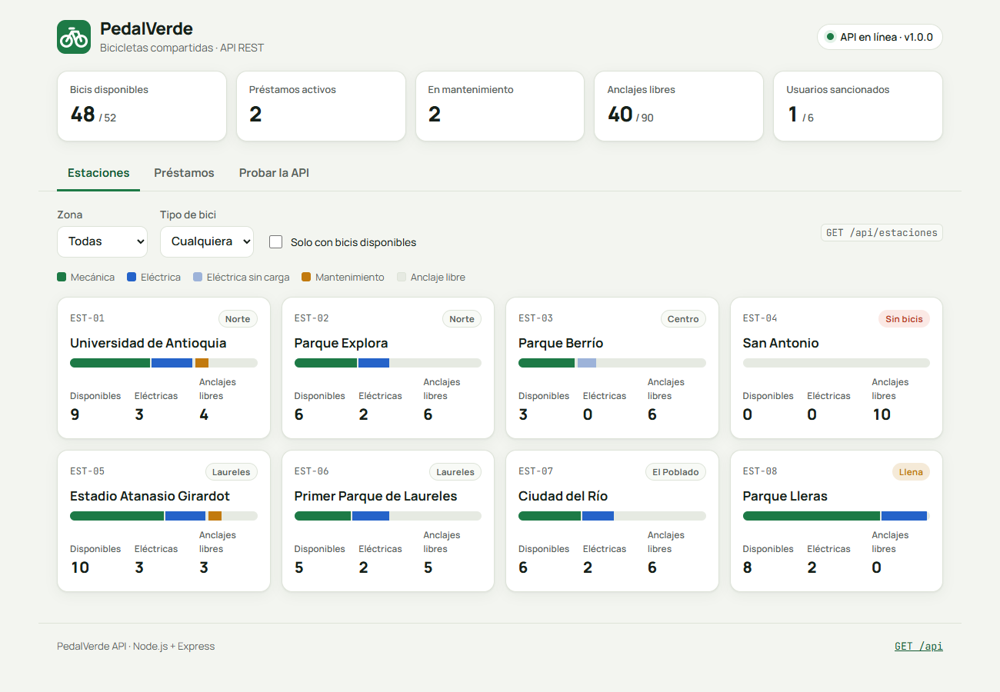
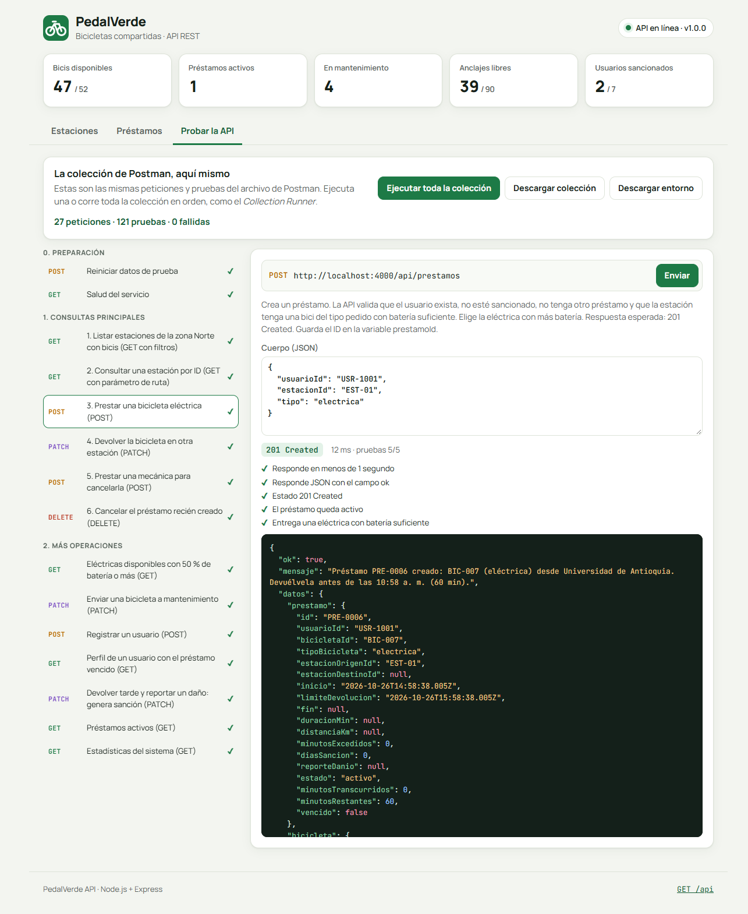
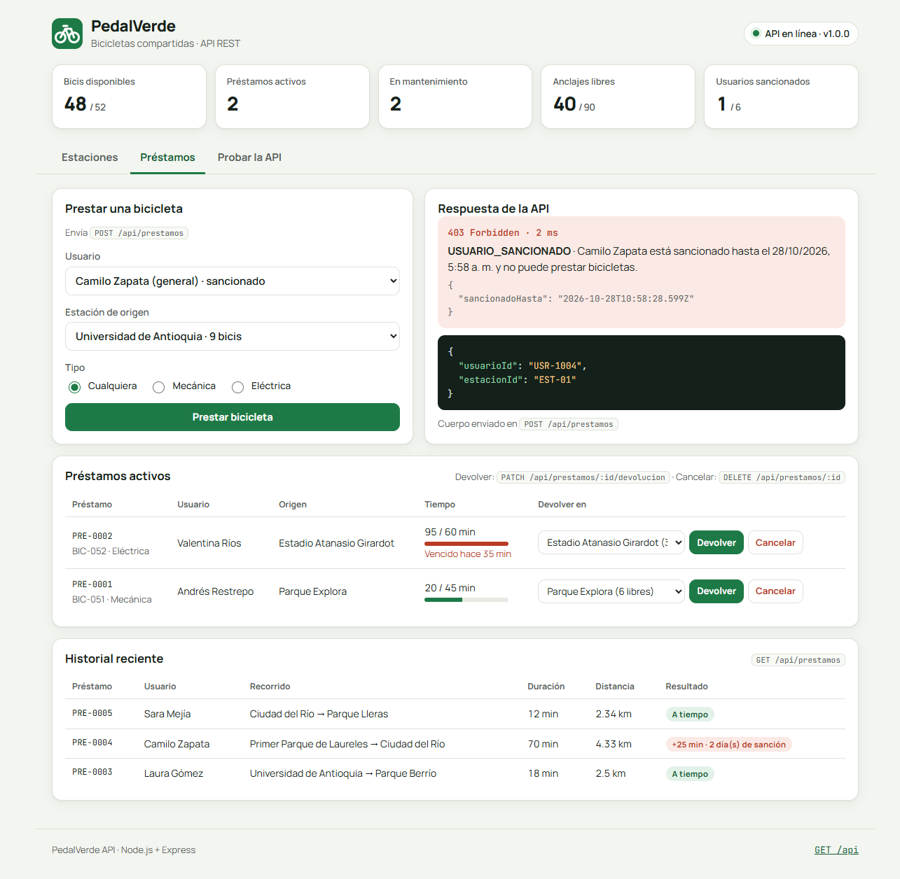
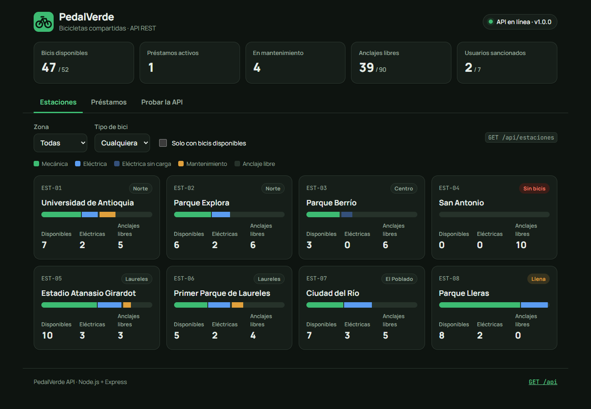
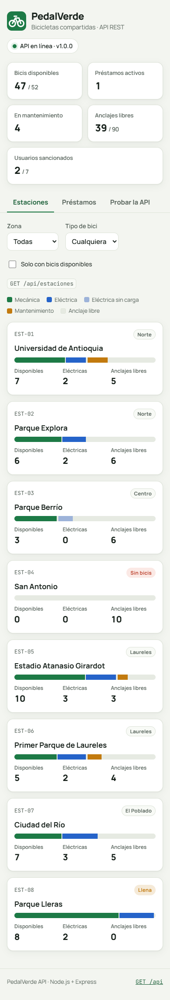

# 🚲 PedalVerde: API REST de bicicletas compartidas

API REST para gestionar un sistema de bicicletas públicas compartidas (estaciones, bicicletas, usuarios y préstamos), con una **consola web** que la consume y una **colección de Postman** con pruebas automáticas.

El sistema aplica reglas de negocio como las de un servicio real: no presta una bici a un usuario sancionado, no deja devolverla en una estación llena (y sugiere las más cercanas con espacio), no presta eléctricas con poca batería y sanciona a quien se pasa del tiempo permitido.



---

## Contenido

- [Qué incluye](#qué-incluye)
- [Instalación y puesta en marcha](#instalación-y-puesta-en-marcha)
- [Reglas de negocio](#reglas-de-negocio)
- [Endpoints](#endpoints)
- [Las consultas en Postman](#las-consultas-en-postman)
- [Cómo importar y ejecutar la colección](#cómo-importar-y-ejecutar-la-colección)
- [Resultados de las pruebas](#resultados-de-las-pruebas)
- [Estructura del proyecto](#estructura-del-proyecto)
- [Tecnologías](#tecnologías)

---

## Qué incluye

| Parte | Descripción |
|---|---|
| **API REST** | Node.js + Express. 18 endpoints con `GET`, `POST`, `PATCH` y `DELETE`, validaciones, códigos HTTP correctos (200, 201, 400, 403, 404, 409) y respuestas JSON uniformes en español. |
| **Datos semilla** | 8 estaciones en Medellín, 52 bicicletas (mecánicas y eléctricas), 6 usuarios y 5 préstamos. Se guardan en memoria y se reinician con `POST /api/reset`. |
| **Consola web** | En `http://localhost:4000`. Mapa de disponibilidad por estación, préstamos y devoluciones, y un probador que ejecuta la colección de Postman desde el navegador. Modo claro y oscuro, adaptable a móvil. |
| **Colección de Postman** | 27 peticiones con 121 comprobaciones automáticas (`pm.test`), variables encadenadas y un entorno listo para importar. |
| **Pruebas automáticas** | 26 pruebas con el test runner nativo de Node (`npm test`), sin dependencias extra. |
| **Documentación** | Este README, la [documentación técnica](DOCUMENTACION_API.md) y los [resultados de Postman](postman/RESULTADOS.md). |

## Instalación y puesta en marcha

Requisitos: **Node.js 18 o superior**.

```bash
git clone https://github.com/esteban4k/api.git
cd api
npm install
npm start
```

Abre **http://localhost:4000** para la consola web, o **http://localhost:4000/api** para ver el índice de la API.

| Comando | Qué hace |
|---|---|
| `npm start` | Enciende la API en el puerto 4000 |
| `npm run dev` | Igual, pero se reinicia sola al guardar cambios |
| `npm test` | Corre las 26 pruebas automáticas |
| `npm run postman` | Corre la colección de Postman desde la terminal con Newman (la API debe estar encendida) |

Para usar otro puerto: `PORT=5000 npm start` (en PowerShell: `$env:PORT=5000; npm start`).

## Reglas de negocio

| Regla | Valor |
|---|---|
| Tiempo máximo por viaje | **Estudiante: 60 min** · **General: 45 min** |
| Sanción por pasarse | 1 día por cada 15 min de exceso (máximo 7 días) |
| Préstamos simultáneos | 1 por usuario |
| Batería mínima para prestar una eléctrica | 20 % |
| Cancelar un préstamo (`DELETE`) | Solo en los primeros 2 minutos |
| Elección de la bici | Eléctrica: la de más batería · Mecánica: la de menos km (reparte el desgaste) |
| Devolución | Solo en estaciones con anclajes libres. Si está llena, la API sugiere las 3 más cercanas con espacio |
| Reporte de daño | Si al devolver se envía `reporteDanio`, la bici queda en mantenimiento |

Los valores están en [src/config.js](src/config.js).

## Endpoints

| Método | Ruta | Descripción |
|---|---|---|
| `GET` | `/api` | Índice de rutas y reglas |
| `GET` | `/api/salud` | Estado del servicio |
| `GET` | `/api/estadisticas` | Resumen de flota, estaciones, préstamos, usuarios y zonas |
| `GET` | `/api/estaciones` | Lista estaciones. Filtros: `zona`, `tipo`, `minDisponibles`, `conAnclajes`, `q` |
| `GET` | `/api/estaciones/:id` | Detalle de una estación con sus bicicletas |
| `GET` | `/api/bicicletas` | Lista bicicletas. Filtros: `estado`, `tipo`, `estacionId`, `bateriaMin` |
| `GET` | `/api/bicicletas/:id` | Detalle, préstamo activo e historial de una bici |
| `PATCH` | `/api/bicicletas/:id/estado` | Enviar a mantenimiento o habilitar |
| `GET` | `/api/usuarios` | Lista usuarios. Filtro: `plan` |
| `GET` | `/api/usuarios/:id` | Perfil, préstamo activo, resumen e historial |
| `POST` | `/api/usuarios` | Registrar un usuario |
| `GET` | `/api/prestamos` | Lista préstamos. Filtros: `estado`, `usuarioId`, `estacionId` |
| `GET` | `/api/prestamos/:id` | Detalle de un préstamo |
| `POST` | `/api/prestamos` | **Prestar una bicicleta** |
| `PATCH` | `/api/prestamos/:id/devolucion` | **Devolver la bicicleta** |
| `DELETE` | `/api/prestamos/:id` | **Cancelar un préstamo reciente** |
| `GET` | `/api/auditoria` | Cambios de estado de las bicicletas |
| `POST` | `/api/reset` | Volver a los datos iniciales |

Todas las respuestas tienen el mismo formato:

```json
// Éxito
{ "ok": true, "mensaje": "…", "datos": { }, "marcaTiempo": "2026-10-26T14:59:29.766Z" }

// Error
{ "ok": false, "error": { "codigo": "ESTACION_LLENA", "mensaje": "…", "detalles": { } }, "marcaTiempo": "…" }
```

## Las consultas en Postman

La colección [`postman/PedalVerde.postman_collection.json`](postman/PedalVerde.postman_collection.json) tiene 4 carpetas. Estas son las consultas principales (carpeta **1. Consultas principales**). Antes de ejecutarlas corre **Reiniciar datos de prueba** (`POST /api/reset`) para partir siempre de los mismos datos.

### 1. Listar estaciones con filtros (GET)

- **Método:** `GET`
- **URL completa:** `http://localhost:4000/api/estaciones?zona=Norte&minDisponibles=1`
- **Qué hace:** devuelve las estaciones de la zona Norte que tienen al menos una bici disponible.
- **Respuesta esperada:** `200 OK`

```json
{
  "ok": true,
  "total": 2,
  "filtros": { "zona": "Norte", "tipo": null, "minDisponibles": 1, "conAnclajes": null, "q": null },
  "datos": [
    {
      "id": "EST-01",
      "nombre": "Universidad de Antioquia",
      "zona": "Norte",
      "capacidad": 14,
      "coordenadas": { "lat": 6.2675, "lng": -75.5686 },
      "disponibilidad": {
        "bicisDisponibles": 9, "mecanicas": 6, "electricas": 3, "electricasSinCarga": 0,
        "enMantenimiento": 1, "anclajesLibres": 4, "ocupacionPct": 71
      }
    },
    { "id": "EST-02", "nombre": "Parque Explora", "zona": "Norte", "...": "..." }
  ],
  "marcaTiempo": "2026-10-26T14:59:29.595Z"
}
```

### 2. Consultar una estación por ID (GET)

- **Método:** `GET`
- **URL completa:** `http://localhost:4000/api/estaciones/EST-01`
- **Qué hace:** devuelve la estación con su disponibilidad y la lista de bicis ancladas.
- **Respuesta esperada:** `200 OK` (o `404 Not Found` si el ID no existe)

```json
{
  "ok": true,
  "datos": {
    "id": "EST-01",
    "nombre": "Universidad de Antioquia",
    "zona": "Norte",
    "capacidad": 14,
    "disponibilidad": { "bicisDisponibles": 9, "anclajesLibres": 4, "ocupacionPct": 71, "...": "..." },
    "prestamosActivosDesdeAqui": 0,
    "bicicletas": [
      { "id": "BIC-001", "tipo": "mecanica", "estado": "disponible", "bateria": null, "kmRecorridos": 157, "nota": null },
      { "id": "BIC-007", "tipo": "electrica", "estado": "disponible", "bateria": 92, "kmRecorridos": 379, "nota": null }
    ]
  }
}
```

### 3. Prestar una bicicleta (POST)

- **Método:** `POST`
- **URL completa:** `http://localhost:4000/api/prestamos`
- **Encabezado:** `Content-Type: application/json`
- **Cuerpo:**

```json
{
  "usuarioId": "USR-1001",
  "estacionId": "EST-01",
  "tipo": "electrica"
}
```

- **Qué hace:** valida que el usuario exista, no esté sancionado y no tenga otra bici; que la estación tenga una eléctrica con batería suficiente; elige la de más batería y la marca `en_uso`.
- **Respuesta esperada:** `201 Created`, con el encabezado `Location: /api/prestamos/PRE-0006`

```json
{
  "ok": true,
  "mensaje": "Préstamo PRE-0006 creado: BIC-007 (eléctrica) desde Universidad de Antioquia. Devuélvela antes de las 10:59 a. m. (60 min).",
  "datos": {
    "prestamo": {
      "id": "PRE-0006",
      "usuarioId": "USR-1001",
      "bicicletaId": "BIC-007",
      "estacionOrigenId": "EST-01",
      "inicio": "2026-10-26T14:59:29.766Z",
      "limiteDevolucion": "2026-10-26T15:59:29.766Z",
      "estado": "activo",
      "minutosTranscurridos": 0,
      "minutosRestantes": 60,
      "vencido": false
    },
    "bicicleta": { "id": "BIC-007", "tipo": "electrica", "estado": "en_uso", "bateria": 92 },
    "usuario": { "id": "USR-1001", "nombre": "Laura Gómez", "plan": "estudiante" }
  }
}
```

### 4. Devolver la bicicleta (PATCH)

- **Método:** `PATCH`
- **URL completa:** `http://localhost:4000/api/prestamos/PRE-0006/devolucion` (en Postman: `{{baseUrl}}/api/prestamos/{{prestamoId}}/devolucion`, el ID lo guarda la consulta 3)
- **Encabezado:** `Content-Type: application/json`
- **Cuerpo:**

```json
{
  "estacionId": "EST-07"
}
```

- **Qué hace:** finaliza el préstamo, calcula duración, distancia y sanción, y deja la bici disponible en la estación destino. Acepta `"reporteDanio": "texto"` opcional.
- **Respuesta esperada:** `200 OK`

```json
{
  "ok": true,
  "mensaje": "Bicicleta BIC-007 devuelta en Ciudad del Río tras 0 min y 6.51 km. Devuelta a tiempo, sin sanción.",
  "datos": {
    "prestamo": { "id": "PRE-0006", "estacionDestinoId": "EST-07", "duracionMin": 0, "distanciaKm": 6.51, "diasSancion": 0, "estado": "finalizado" },
    "bicicleta": { "id": "BIC-007", "estado": "disponible", "estacionId": "EST-07", "kmRecorridos": 385.5 },
    "sancion": { "aplicada": false, "dias": 0, "hasta": null }
  }
}
```

### 5. Cancelar un préstamo (DELETE)

- **Método:** `DELETE`
- **URL completa:** `http://localhost:4000/api/prestamos/PRE-0007` (la colección primero crea ese préstamo con un `POST`)
- **Qué hace:** cancela un préstamo de menos de 2 minutos y devuelve la bici a su estación de origen.
- **Respuesta esperada:** `200 OK` (o `409 Conflict` si pasaron más de 2 minutos)

```json
{
  "ok": true,
  "mensaje": "Préstamo PRE-0007 cancelado. BIC-025 volvió a Estadio Atanasio Girardot.",
  "datos": {
    "prestamo": { "id": "PRE-0007", "estado": "cancelado", "estacionDestinoId": "EST-05" },
    "bicicleta": { "id": "BIC-025", "estado": "disponible", "estacionId": "EST-05" }
  }
}
```

### Ejemplo de error: devolver en una estación llena

- **Método:** `PATCH`
- **URL completa:** `http://localhost:4000/api/prestamos/PRE-0001/devolucion`
- **Cuerpo:** `{ "estacionId": "EST-08" }`
- **Respuesta esperada:** `409 Conflict`

```json
{
  "ok": false,
  "error": {
    "codigo": "ESTACION_LLENA",
    "mensaje": "Parque Lleras no tiene anclajes libres. Prueba en una estación cercana.",
    "detalles": {
      "sugerencias": [
        { "id": "EST-07", "nombre": "Ciudad del Río", "distanciaKm": 1.8, "anclajesLibres": 5 },
        { "id": "EST-04", "nombre": "San Antonio", "distanciaKm": 4.27, "anclajesLibres": 10 }
      ]
    }
  }
}
```

La carpeta **3. Errores y validaciones** tiene 12 casos así (usuario sancionado → 403, estación vacía → 409, JSON mal escrito → 400, ID inexistente → 404, etc.).

## Cómo importar y ejecutar la colección

1. Enciende la API con `npm start`.
2. En Postman: **Import** → arrastra los dos archivos de la carpeta [`postman/`](postman/):
   - `PedalVerde.postman_collection.json` (la colección)
   - `PedalVerde.local.postman_environment.json` (el entorno, con `baseUrl = http://localhost:4000`)
3. Arriba a la derecha elige el entorno **PedalVerde local**.
4. Clic derecho sobre la colección → **Run collection** → **Run**. Se ejecutan en orden y cada una muestra sus pruebas en verde.

También puedes descargar ambos archivos desde la pestaña **Probar la API** de la consola web, o correr todo desde la terminal:

```bash
npm run postman
```

## Resultados de las pruebas

**Postman (Newman):** 27 peticiones y 121 comprobaciones, **0 fallidas**. Tabla completa y respuestas reales en [postman/RESULTADOS.md](postman/RESULTADOS.md).

| Petición | Método | Estado | Pruebas |
|---|---|---|---|
| Listar estaciones de la zona Norte con bicis | GET | 200 OK | 5/5 |
| Consultar una estación por ID | GET | 200 OK | 5/5 |
| Prestar una bicicleta eléctrica | POST | 201 Created | 5/5 |
| Devolver la bicicleta en otra estación | PATCH | 200 OK | 6/6 |
| Cancelar el préstamo recién creado | DELETE | 200 OK | 5/5 |
| Devolver tarde y reportar un daño (sanción de 3 días) | PATCH | 200 OK | 5/5 |
| Usuario sancionado no puede prestar | POST | 403 Forbidden | 5/5 |
| Devolver en una estación llena | PATCH | 409 Conflict | 5/5 |
| Campos inválidos | POST | 400 Bad Request | 5/5 |
| … 18 peticiones más | | | |

**Pruebas del backend (`npm test`):** 26 pruebas, 0 fallidas.

La pestaña **Probar la API** de la consola web corre la misma colección desde el navegador y muestra cada prueba:



## Estructura del proyecto

```text
api/
├── server.js                  # Arranque del servidor
├── src/
│   ├── app.js                 # Express: middlewares, rutas y manejo de errores
│   ├── config.js              # Reglas de negocio (límites, sanciones, batería)
│   ├── datos/
│   │   ├── semilla.js         # Datos iniciales
│   │   └── db.js              # Base de datos en memoria y reinicio
│   ├── rutas/                 # Un archivo por recurso
│   │   ├── estaciones.js
│   │   ├── bicicletas.js
│   │   ├── usuarios.js
│   │   ├── prestamos.js
│   │   └── sistema.js         # /api, salud, estadísticas, auditoría, reset
│   ├── servicios/             # Lógica de negocio
│   │   ├── estaciones.js      # Disponibilidad y estaciones cercanas
│   │   └── prestamos.js       # Prestar, devolver, cancelar y sancionar
│   └── utils/                 # Respuestas, validación, fechas y distancias
├── public/                    # Consola web (HTML, CSS y JS sin frameworks)
├── postman/                   # Colección, entorno y resultados
├── tests/api.test.js          # Pruebas automáticas
├── docs/capturas/             # Capturas de pantalla
├── DOCUMENTACION_API.md       # Documentación técnica completa
└── package.json
```

## Tecnologías

- **Backend:** Node.js 18+ y Express 5.
- **Frontend:** HTML, CSS y JavaScript sin frameworks.
- **Pruebas:** Postman (colección v2.1 con `pm.test`), Newman y `node:test`.

| Préstamos | Modo oscuro | Móvil |
|---|---|---|
|  |  |  |
